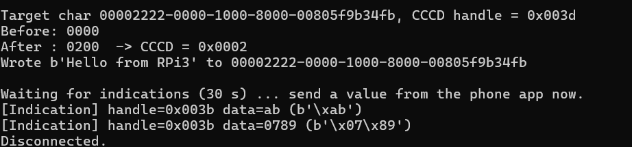
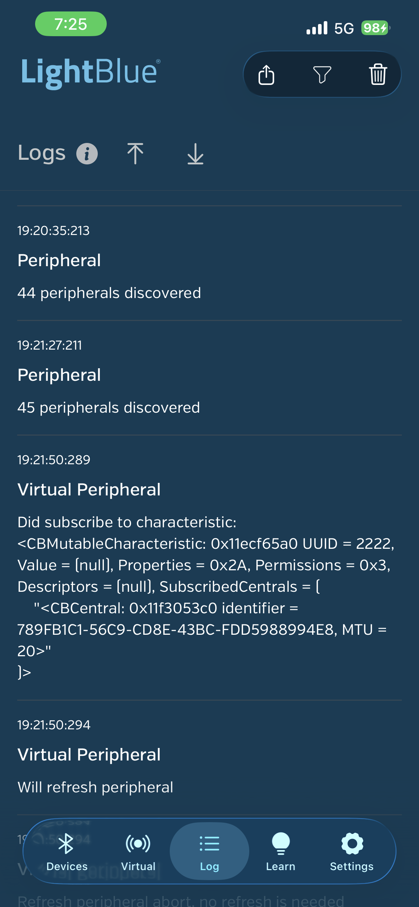
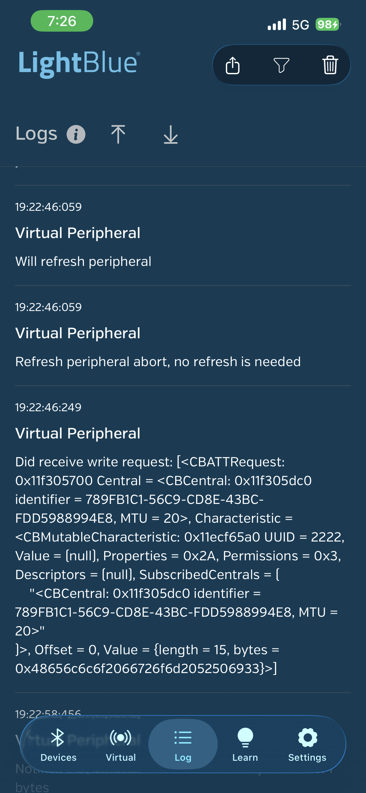

# BLE Central on Raspberry Pi — CCCD Demo (HW3)

用 Python（bluepy）在 Raspberry Pi 上實作 **BLE Central**，連線到手機上的 GATT Server，並將目標 characteristic 的 **CCCD 設為 `0x0002`（開啟 Indication）**。

加分題：在同一台 Pi 上編譯安裝 C 語言 BLE 函式庫 [gattlib](https://github.com/labapart/gattlib) 並執行其範例，詳見 [`docs/gattlib.md`](docs/gattlib.md)。

## 架構

```
┌──────────────────────────┐        BLE         ┌──────────────────────────┐
│ Raspberry Pi 4           │  ───────────────▶  │ iPhone (LightBlue)       │
│ Central / GATT Client    │   write CCCD=0x0002│ Peripheral / GATT Server │
│ ble_central_cccd.py      │  ◀───────────────  │ Virtual Device "Blank"   │
│ (bluepy)                 │     Indication     │ Char UUID 0x2222         │
└──────────────────────────┘                    └──────────────────────────┘
```

- 手機扮演 **GATT Server（Peripheral）**：廣播並提供 characteristic。
- Pi 扮演 **Central（Client）**：掃描、連線、寫入 CCCD、接收 indication。

## CCCD 說明

CCCD（Client Characteristic Configuration Descriptor）UUID 為 `0x2902`，長度 2 bytes，little-endian：

| 值 | 意義 | 實際寫入的 bytes |
|---|---|---|
| `0x0000` | 關閉 | `00 00` |
| `0x0001` | 開啟 Notification | `01 00` |
| `0x0002` | 開啟 Indication | `02 00` |

## 環境

| 項目 | 版本 |
|---|---|
| 硬體 | Raspberry Pi 4 |
| 系統 | Raspberry Pi OS 64-bit（Debian trixie，BlueZ 5.82） |
| Python | 3.13 + bluepy 1.3.0 |
| 手機 | iPhone + LightBlue（Virtual Devices → Blank） |

## 安裝

```bash
sudo apt update
sudo apt install -y python3-pip libglib2.0-dev build-essential
sudo pip3 install bluepy --break-system-packages
sudo rfkill unblock bluetooth
bluetoothctl power on
```

## 手機端設定（LightBlue）

1. **Virtual** 分頁 → 「+」→ 選 **Blank**。
2. characteristic（本例 UUID `2222`）勾選 **Read / Write / Indicate**。
3. 開啟 virtual device 開始廣播，並讓 app 保持在前景。

## 執行

```bash
sudo python3 ble_central_cccd.py 2222
```

- 參數為目標 characteristic 的 UUID（16-bit 會自動補成完整 128-bit）；不給參數時，程式會自動挑第一個具有 INDICATE 屬性的自訂 characteristic。
- 掃描 10 秒後列出裝置，輸入名稱為 `Blank` 的編號。

程式流程：

1. 掃描並列出附近的 BLE 裝置
2. 連線後列出所有 service / characteristic（略過 GAP、GATT 及 iPhone 內建的 Apple 服務）
3. 讀取 CCCD → 寫入 `02 00` → 讀回確認為 `0x0002`
4. 寫入字串 `Hello from RPi3`，驗證雙向通訊
5. 等待 30 秒，接收手機送出的 indication

## 結果

### Pi 端：CCCD 由 `0x0000` 改為 `0x0002`，並收到 indication



### iPhone 端（LightBlue Log）

| 訂閱 characteristic | 收到 Pi 的寫入 |
|---|---|
|  |  |

- 左圖：Pi 訂閱了 UUID `2222`。該 characteristic 的 `Properties = 0x2A` = Read (0x02) + Write (0x08) + **Indicate (0x20)**，沒有 Notify (0x10)，因此這次訂閱對應的 CCCD 值只可能是 `0x0002`。
- 右圖：收到的 bytes `0x48656c6c6f2066726f6d2052506933` = ASCII `Hello from RPi3`。

> iOS 的 CoreBluetooth 會自行管理 CCCD，LightBlue 的 log 不會顯示原始寫入值 `02 00`，因此以 Central 端讀回的 CCCD 值，搭配 Peripheral 端的訂閱紀錄作為證明。

## 遇到的問題與解法

| 問題 | 原因 | 解法 |
|---|---|---|
| `BTLEManagementError: Failed to execute management command 'scanend' (code: 11, error: Rejected)` | 新版 BlueZ 有時拒絕 bluepy 的停止掃描指令 | 改用 `start()` / `process()` / `stop()`，並捕捉 `stop()` 的例外，掃描結果仍可使用 |
| 自動選到錯誤的 characteristic | GATT Service（0x1801）的 Service Changed 及 iPhone 內建 Apple 服務也有 Indicate 屬性 | 建立 `SKIP_SERVICES` 略過這些服務，並支援以參數指定目標 UUID |
| 掃描結果中找不到 iPhone | iOS 使用隨機 MAC 位址，且 app 在背景時廣播不帶名稱 | 讓 LightBlue 保持前景，用名稱 `Blank` 或 RSSI 辨識 |

## 檔案結構

```
.
├── ble_central_cccd.py      # 主程式（Python / bluepy）
├── docs/
│   └── gattlib.md           # 加分題：gattlib 編譯安裝與範例
├── scripts/
│   └── build_gattlib.sh     # gattlib 一鍵編譯安裝腳本
└── images/                  # Demo 截圖
```

## 參考資料

- [bluepy](https://github.com/IanHarvey/bluepy)
- [gattlib](https://github.com/labapart/gattlib)
- Bluetooth Core Specification — Client Characteristic Configuration (0x2902)
