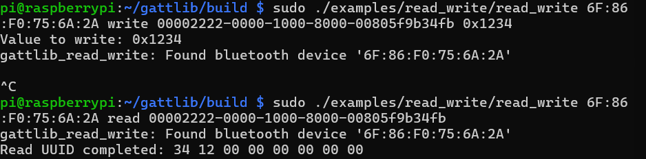

# 加分題：使用 gattlib（C 語言）進行 BLE 程式設計

[gattlib](https://github.com/labapart/gattlib) 是一個 C 語言的 BLE GATT 函式庫。在 BlueZ 5.42 以後的版本，它透過 BlueZ 的 **D-Bus API** 運作（本機為 BlueZ 5.82），不像 bluepy 透過 `bluepy-helper` 直接操作 HCI。

## 1. 安裝相依套件

```bash
sudo apt install -y git cmake build-essential pkg-config \
    libbluetooth-dev libreadline-dev libglib2.0-dev libpcre2-dev
```

## 2. 下載、修正並編譯

```bash
cd ~
git clone https://github.com/labapart/gattlib.git
cd gattlib

# Debian trixie 已移除舊版 libpcre，改用 libpcre2-8
grep -rl "REQUIRED libpcre)" --include=CMakeLists.txt . \
    | xargs sed -i 's/REQUIRED libpcre)/REQUIRED libpcre2-8)/'

mkdir build && cd build
cmake -DGATTLIB_BUILD_DOCS=OFF -DGATTLIB_PYTHON_INTERFACE=OFF ..
make -j4
sudo make install
sudo ldconfig
```

也可以直接執行 [`scripts/build_gattlib.sh`](../scripts/build_gattlib.sh) 完成以上步驟。

### 編譯問題：找不到 `libpcre`

```
CMake Error at /usr/share/cmake-3.31/Modules/FindPkgConfig.cmake:938 (message):
  None of the required 'libpcre' found
Call Stack (most recent call first):
  examples/ble_scan/CMakeLists.txt:27 (pkg_search_module)
```

- **原因**：Debian trixie 已不提供舊版 PCRE（`libpcre3-dev`），只剩 PCRE2；而 gattlib 範例的 `CMakeLists.txt` 仍以 `pkg_search_module(PCRE REQUIRED libpcre)` 尋找舊版。
- **解法**：範例程式只在連結階段使用 pcre，因此將所有範例的 `libpcre` 改成 `libpcre2-8` 即可正常編譯。

## 3. 執行範例

以下指令皆在 `~/gattlib/build` 中執行，iPhone 的 LightBlue「Blank」需開啟並保持前景。

### 取得 iPhone 目前的 MAC 位址

iPhone 使用隨機位址，大約每 15 分鐘會更換，每次執行前先確認：

```bash
bluetoothctl --timeout 10 scan le | grep -i blank
# [NEW] Device 6F:86:F0:75:6A:2A Blank
```

### ble_scan：掃描並連線

```bash
sudo ./examples/ble_scan/ble_scan 2>&1 | grep -v "Failed to get service"
```

成功連上 iPhone 時列出的 characteristic（節錄）：

```
characteristic[3] properties:12 value_handle:001a uuid:0x2a19
characteristic[4] properties:2a value_handle:003a uuid:0x2222
characteristic[6] properties:20 value_handle:0007 uuid:0x2a05
```

| UUID | properties | 說明 |
|---|---|---|
| `0x2222` | `0x2A` | LightBlue 自訂的 characteristic：Read + Write + Indicate，與 LightBlue log 中的 `Properties = 0x2A` 一致 |
| `0x2A19` | `0x12` | Battery Level：Read + Notify |
| `0x2A05` | `0x20` | Service Changed：Indicate |

說明：

- `Failed to get service '.../serviceXXXX/charYYYY'`：gattlib 在走訪 BlueZ 物件樹時，把 characteristic 的路徑也當成 service 嘗試讀取而產生的訊息，不影響結果，因此用 `grep -v` 過濾。
- `le-connection-abort-by-local`、`cannot be found`：`ble_scan` 會逐一嘗試連線附近所有裝置，其他人的裝置不接受連線或已離開範圍，屬正常現象。

### discover：列出指定裝置的 service / characteristic

```bash
sudo ./examples/discover/discover 6F:86:F0:75:6A:2A 2>&1 | grep -v "Failed to get service"
```

偶爾會因 `le-connection-abort-by-local` 連線失敗，重試即可；若持續失敗，可先清除 BlueZ 的舊紀錄：

```bash
bluetoothctl remove 6F:86:F0:75:6A:2A
sudo systemctl restart bluetooth
```

### read_write：讀寫 characteristic

```bash
sudo ./examples/read_write/read_write 6F:86:F0:75:6A:2A write 00002222-0000-1000-8000-00805f9b34fb 0x1234
sudo ./examples/read_write/read_write 6F:86:F0:75:6A:2A read  00002222-0000-1000-8000-00805f9b34fb
```

#### 結果



```
Value to write: 0x1234
gattlib_read_write: Found bluetooth device '6F:86:F0:75:6A:2A'
^C
...
Read UUID completed: 34 12 00 00 00 00 00 00
```

寫入 `0x1234` 後讀回 `34 12 00 00 00 00 00 00`，證明 C 程式透過 gattlib 成功寫入並讀取 iPhone 上的 characteristic `0x2222`。

#### 為什麼是 `34 12 00 00 00 00 00 00`？

範例程式以 `strtol()` 將命令列的 `0x1234` 轉成 `long`，再把這個變數在記憶體中的原始 bytes 寫出：

- Raspberry Pi 的 ARM CPU 為 **little-endian**，低位元組在前，`0x1234` 在記憶體中是 `34 12`。
- 64-bit 系統（aarch64，LP64）的 `long` 為 **8 bytes**，因此後面補上 6 個 `00`。

所以實際傳送與讀回的資料都是 8 bytes：`34 12 00 00 00 00 00 00`。這與 Basic Problem 中將 CCCD `0x0002` 寫成 `02 00` 是同一個原理：BLE 中的多位元組數值以 little-endian 傳輸。

#### write 卡住 / D-Bus 逾時

```
gattlib_read_write: Failed to write DBus GATT characteristic: Timeout was reached (161,24)
gattlib_read_write: Error while writing GATT Characteristic with UUID 0x2222 (ret:268476696)
```

- `read_write` 使用需要對方回應的 **Write Request**。LightBlue 的 virtual device 有時收到資料後未及時回覆 Write Response，BlueZ 等待約 25 秒後回報逾時。
- 第一次寫入 `0x1234` 時程式停在連線後的步驟，以 Ctrl+C 結束；但後續 read 讀回了寫入值，表示資料已送達，只是回應遺失。
- 判斷方式：逾時後立刻執行 read，若讀回的是本次寫入的值，代表寫入已生效。
- 改善方式：讓 LightBlue 保持前景、螢幕不鎖定，必要時關閉再開啟 virtual device，並重新取得 MAC 位址後重試。

## 4. bluepy 與 gattlib 比較

| | bluepy（Basic Problem） | gattlib（加分題） |
|---|---|---|
| 語言 | Python | C |
| 與藍牙堆疊的介面 | `bluepy-helper` 直接操作 HCI / L2CAP | BlueZ D-Bus API（`org.bluez.*`） |
| CCCD 設定 | 直接對 CCCD handle 寫入 `02 00` | `gattlib_notification_start()` 由 BlueZ 處理 CCCD；或手動寫入 handle + 1 |
| 優點 | 寫法簡潔，可直接控制 handle | 與系統 BlueZ 整合，可多程式共用藍牙 |
| 遇到的問題 | 新版 BlueZ 拒絕 `scanend` | 新系統缺少 `libpcre`；D-Bus 物件走訪產生大量警告；iOS 端 Write Response 遺失導致 D-Bus 逾時 |

## 5. 結論

- 成功在 Raspberry Pi 4（Debian trixie、BlueZ 5.82）上編譯並安裝 gattlib，過程中修正了範例對舊版 `libpcre` 的相依。
- `ble_scan` 成功連線 iPhone 並列出完整的 GATT 表，其中 `0x2222` 的 properties `0x2A` 與 LightBlue 的設定一致。
- `read_write` 成功以 C 語言寫入並讀回 characteristic 的值，並從結果觀察到 ARM 的 little-endian 與 `long` 的 8-byte 表示法。
